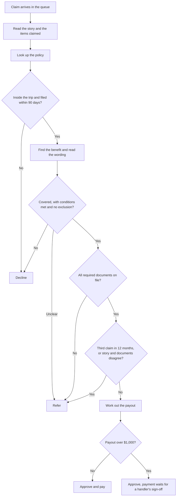

# 3. Process map

**A worked example.** The timings below are invented. See `README.md`.

Drawn from two days sitting with the handlers, 14 and 15 September 2026, and checked with the Head of Claims Operations on 16 September.

## Why this step

A process map shows where the time goes and which steps need judgement. It also shows which steps are plain rules. Those belong in code, not in an agent: if the process is A, then B, then C, write it as code. The map is where you decide what the model should do and what the code should do.

## How a claim is worked today

The handlers follow section 4 of the claims manual, in the same order every time.

## Each step

Minutes are the median for a routine claim, from the 50 claims we watched.

| Step | System | Minutes | Kind of work | Who should do it |
|---|---|---|---|---|
| Read the story and the items | Claims system | 4 | Reading | Model |
| Look up the policy | Policy administration | 3 | Finding | Code |
| Check the trip dates and the 90-day window | By hand | 1 | Rule with numbers | Code |
| Find the benefit and read the wording | Shared folder | 6 | Judgement | Model |
| Check conditions and exclusions, using the manual | Shared folder | 5 | Judgement | Model |
| Read every document | Claims system | 7 | Reading and judgement | Model |
| Check the required documents are there | By hand | 2 | Checklist, with judgement | Model, checked by code |
| Look at the claim history | Customer system | 3 | Finding, then a rule | Code |
| Work out the payout | Payout spreadsheet | 5 | Rule with numbers | Code |
| Record the decision and the reason | Claims system | 4 | Writing | Model |
| **Total** | | **40** | | |

Hard claims took far longer, from one to three hours with a median of 75 minutes, mostly reading medical records and documents that disagree.

## What the map shows

- **About two thirds of the time is judgement, reading and writing**: is it covered, which benefit, what do the documents say. That is work for a model.
- **The other third is finding and rules**: looking things up across three systems, dates, limits, the deductible and the repeat-claim count. That is work for code, given to the model as tools.
- **The $1,000 sign-off is a rule**, not a judgement. It belongs in the system that pays, so no agent can get round it.
- **Nothing flags a third claim in 12 months.** Handlers catch it by habit. Code can count it every time.

## What it produced

- The split between model and code, carried into the use case in `06_use_cases.md` and the autonomy levels in `08_autonomy_and_risk.md`.
- The timings for the baseline in `05_baseline.md`.
- The list of systems to request data from in `04_data_requests.md`: claims, policy administration, customers, and the shared folder holding the wording and the manual.
